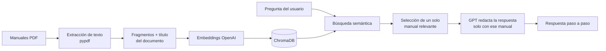

# Asistente IA de Procesos

Asistente conversacional que responde preguntas sobre los procedimientos internos de una empresa usando sus propios manuales en PDF. Funciona con **RAG** (generación aumentada por recuperación): busca el manual correcto y responde solo con lo que dice la documentación, sin inventar pasos.

Desarrollé este asistente originalmente para un equipo de analistas de procesos en un entorno empresarial real. Esta versión pública usa una **empresa ficticia (Andina Servicios S.A.S.)** y **manuales de ejemplo**, sin datos de ninguna organización.

## Qué hace

- **Chat sobre los manuales (RAG):** responde paso a paso con base en el manual que corresponde y recuerda el caso para preguntas de seguimiento.
- **Modo experto:** explica conceptos generales (flujos BPM, etapas, validaciones) cuando la pregunta no es un procedimiento documentado.
- **Análisis de imágenes:** el usuario adjunta una captura de pantalla del sistema y el asistente la interpreta junto con la documentación (GPT-4o-mini con visión).
- **Video a manual:** transcribe un video de capacitación con Whisper y lo convierte en un manual PDF con resúmenes por etapas (map-reduce).
- **Copiloto de reunión:** app aparte que graba una pregunta por micrófono, la transcribe y responde con el contexto del proyecto.
- **Administración:** inicio de sesión con contraseñas cifradas (bcrypt), roles, enlaces de invitación firmados que caducan, estadísticas de uso y modo mantenimiento.

## Cómo funciona



1. **Indexación:** cada PDF se divide en fragmentos y cada fragmento lleva el título del documento, para que la búsqueda acierte el caso correcto.
2. **Recuperación:** la pregunta se compara con los fragmentos en ChromaDB.
3. **Selección:** se combina la similitud semántica con el título para quedarse con un solo manual y no mezclar procedimientos.
4. **Generación:** el modelo responde con reglas estrictas para no inventar pasos, datos ni consultas SQL.

Cualquier carpeta en la raíz del proyecto que contenga PDFs se detecta como una sección y se indexa al iniciar.

## Tecnologías

| Área | Herramientas |
| --- | --- |
| IA | OpenAI API (GPT-3.5, GPT-4o-mini, Whisper), LangChain, embeddings |
| Base vectorial | ChromaDB |
| Aplicación | Python 3.11, Streamlit |
| Documentos | pypdf, fpdf2 |
| Seguridad | bcrypt, tokens HMAC para invitaciones |
| Despliegue | Docker, Render o Streamlit Community Cloud |

## Manuales de ejemplo incluidos

| Carpeta | Manuales |
| --- | --- |
| `Manual Solicitudes` | Radicar una solicitud, Reasignar un caso bloqueado, Cerrar un caso |
| `Manual Facturacion` | Corregir datos de una factura, Validar pagos no aplicados |

Preguntas para probar:
- "¿Cómo reasigno un caso que lleva días sin moverse?"
- "Dame la consulta para ver pagos no aplicados."
- "¿Qué hago si la factura ya tiene pagos y el cliente pide corregir el NIT?"

## Ejecutar en local

Requiere Python 3.11.

```bash
python3.11 -m venv venv
source venv/bin/activate          # En Windows: venv\Scripts\activate
pip install -r requirements.txt
cp .env.example .env              # y completa tus valores
streamlit run app.py
```

Variables de entorno:

| Variable | Para qué sirve |
| --- | --- |
| `OPENAI_API_KEY` | Clave de OpenAI (obligatoria) |
| `ADMIN_USER` / `ADMIN_PASSWORD` | Usuario administrador inicial (obligatorio para iniciar sesión) |
| `INVITE_SEED` | Frase secreta para firmar los enlaces de invitación (recomendada) |

No hay contraseñas escritas en el código: el administrador sale de las variables de entorno y los demás usuarios se crean desde el panel o en Streamlit Secrets.

## Desplegar

- **Render:** el archivo `render.yaml` crea el servicio con Docker. Define las variables de entorno en el panel de Render.
- **Streamlit Community Cloud:** apunta a `app.py` y agrega las variables en *Settings → Secrets*.
- **Copiloto de reunión:** se despliega como una app aparte apuntando a `copiloto_reunion.py`.

## Autor

**Kevin Sebastian Siabato Salgado** · Bogotá, Colombia
[LinkedIn](https://www.linkedin.com/in/devkevin-sebastian-siabato-salgado/) · [GitHub](https://github.com/sebassisamiami-sketch)
