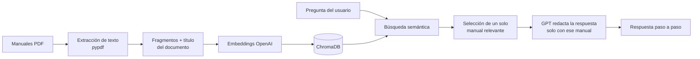

# Asistente IA de Procesos

Asistente conversacional que responde preguntas sobre los procedimientos internos de una empresa usando sus propios manuales en PDF. Funciona con **RAG** (generación aumentada por recuperación): busca el manual correcto y responde solo con lo que dice la documentación, sin inventar pasos.

Desarrollé este asistente originalmente para un equipo de analistas de procesos en un entorno empresarial real. Esta versión pública usa una **empresa ficticia (Andina Servicios S.A.S.)** y **manuales de ejemplo**, sin datos de ninguna organización.

## Qué hace

- **Chat sobre los manuales (RAG):** responde paso a paso con base en el manual que corresponde y recuerda el caso para preguntas de seguimiento.
- **Modo experto:** explica conceptos generales (flujos BPM, etapas, validaciones) cuando la pregunta no es un procedimiento documentado.
- **Análisis de imágenes:** el usuario adjunta una captura de pantalla del sistema y el asistente la interpreta junto con la documentación (GPT-4o-mini con visión).
- **Video a manual:** transcribe un video de capacitación con Whisper y lo convierte en un manual PDF con resúmenes por etapas (map-reduce).
- **Copiloto de reunión:** app aparte que graba una pregunta por micrófono, la transcribe y responde con el contexto del proyecto.
- **Administración:** inicio de sesión con contraseñas cifradas (bcrypt), roles, enlaces de invitación firmados que caducan, estadísticas de uso y modo mantenimiento.

## Cómo funciona



1. **Indexación:** cada PDF se divide en fragmentos y cada fragmento lleva el título del documento, para que la búsqueda acierte el caso correcto.
2. **Recuperación:** la pregunta se compara con los fragmentos en ChromaDB.
3. **Selección:** se combina la similitud semántica con el título para quedarse con un solo manual y no mezclar procedimientos.
4. **Generación:** el modelo responde con reglas estrictas para no inventar pasos, datos ni consultas SQL.

Cualquier carpeta en la raíz del proyecto que contenga PDFs se detecta como una sección y se indexa al iniciar.

## Tecnologías

| Área | Herramientas |
| --- | --- |
| IA (local) | Ollama (qwen2.5, nomic-embed-text, llava) + faster-whisper |
| IA (nube, opcional) | OpenAI API (GPT-3.5, GPT-4o-mini, Whisper) |
| Orquestación | LangChain, embeddings |
| Base vectorial | ChromaDB |
| Aplicación | Python 3.11, Flask (web) |
| Documentos | pypdf, fpdf2 |
| Seguridad | bcrypt, tokens HMAC para invitaciones |
| Despliegue | Docker, Render |

## Manuales de ejemplo incluidos

| Carpeta | Manuales |
| --- | --- |
| `Manual Solicitudes` | Radicar una solicitud, Reasignar un caso bloqueado, Cerrar un caso |
| `Manual Facturacion` | Corregir datos de una factura, Validar pagos no aplicados |

Preguntas para probar:
- "¿Cómo reasigno un caso que lleva días sin moverse?"
- "Dame la consulta para ver pagos no aplicados."
- "¿Qué hago si la factura ya tiene pagos y el cliente pide corregir el NIT?"

## Ejecutar en local

Es una app **web con Flask** (ya no usa Streamlit). Requiere Python 3.11.

```bash
python3.11 -m venv venv
source venv/bin/activate          # En Windows: venv\Scripts\activate
pip install -r requirements.txt
cp .env.example .env              # y completa tus valores
python servidor.py
```

Se abre en **http://localhost:8501** (puedes cambiar el puerto con `PORT`).

Variables de entorno:

| Variable | Para qué sirve |
| --- | --- |
| `LLM_PROVIDER` | `ollama` (local, por defecto) u `openai` (nube) |
| `OPENAI_API_KEY` | Clave de OpenAI (solo si `LLM_PROVIDER=openai`) |
| `ADMIN_USER` / `ADMIN_PASSWORD` | Usuario administrador inicial (obligatorio para iniciar sesión) |
| `INVITE_SEED` | Frase secreta para firmar los enlaces de invitación (recomendada) |

> Para correr sin OpenAI, en modo 100% local, mira la sección
> **"Ejecutar 100% en local con Ollama"** más abajo.

No hay contraseñas escritas en el código: el administrador sale de las variables de entorno (`ADMIN_USER` / `ADMIN_PASSWORD`) y los demás usuarios se crean desde el panel de administración.

## Ejecutar 100% en local con Ollama (sin OpenAI)

El asistente puede correr **totalmente offline**, sin claves ni costos, usando
[Ollama](https://ollama.com). Se controla con la variable `LLM_PROVIDER=ollama`
(valor por defecto en `.env.example`).

Modelos recomendados (caben en una GPU de 6 GB como una RTX 3050):

| Función | Modelo Ollama | Tamaño aprox. |
| --- | --- | --- |
| Chat / RAG | `qwen2.5:7b-instruct` | ~4.7 GB |
| Embeddings | `nomic-embed-text` | ~0.3 GB |
| Visión (imágenes) | `llava:7b` | ~4.7 GB |
| Transcripción | faster-whisper `small` | ~0.5 GB |

### Pasos

1. **Instala Ollama** desde https://ollama.com y verifica que el servicio está activo:
   ```bash
   ollama --version
   ```
2. **Descarga los modelos** (una sola vez):
   ```bash
   ollama pull qwen2.5:7b-instruct
   ollama pull nomic-embed-text
   ollama pull llava:7b            # solo si vas a analizar imágenes
   ```
3. **Instala las dependencias de Python** (incluye faster-whisper para transcribir):
   ```bash
   pip install -r requirements.txt
   ```
4. **Crea tu `.env`** a partir de `.env.example` (ya viene en modo local) y define
   al menos `ADMIN_USER` y `ADMIN_PASSWORD`.
5. **Arranca la app:**
   ```bash
   python servidor.py
   ```
   Y abre **http://localhost:8501**.

Al iniciar, los PDFs de las carpetas de manuales se indexan en ChromaDB con los
embeddings locales. La primera respuesta puede tardar unos segundos mientras
Ollama carga el modelo en memoria.

### Notas de rendimiento (6 GB de VRAM)

- Si el chat va lento o se queda sin VRAM, usa un modelo más pequeño:
  `OLLAMA_MODEL=qwen2.5:3b-instruct` (o `llama3.2:3b`).
- La transcripción por GPU (CUDA) necesita las librerías de NVIDIA (cuBLAS/cuDNN).
  Si no las tienes, deja `WHISPER_DEVICE=cpu`: es más lento pero funciona siempre.
- Chat, embeddings y visión no corren a la vez por GPU, así que 6 GB bastan para
  el uso normal de la demo.

### Volver a OpenAI (nube)

Cambia en tu `.env`:
```
LLM_PROVIDER=openai
OPENAI_API_KEY=sk-...
```
El código es el mismo; solo cambia el proveedor.

> ⚠️ Los embeddings locales (`nomic-embed-text`) y los de OpenAI no son
> compatibles entre sí. Si cambias de proveedor, borra `data/db/chroma_db` y
> deja que la app vuelva a indexar los PDFs.

## Estructura (web con Flask)

- `servidor.py` — servidor Flask: login, chat, visión, panel de administración, enlaces de invitación y copiloto.
- `backend_web.py` — usuarios, roles, estado de mantenimiento y registros de acceso.
- `templates/` y `static/` — interfaz (HTML, CSS y JS; sin frameworks externos).
- `config_local.py` — proveedor de IA (Ollama/OpenAI) y modelos.
- `ia_motor.py`, `chat_procesos.py`, `procesar_datos.py`, `vision_chat.py`,
  `video_a_manual.py`, `transcripcion_local.py` — motor RAG, indexación y multimedia.

El **copiloto de reunión** ahora es una página dentro de la misma app (`/copiloto`),
ya no una app Streamlit aparte. Los archivos `app.py` y `copiloto_reunion.py` de la
versión anterior en Streamlit quedan obsoletos y pueden eliminarse.

## Desplegar

- **Render:** el archivo `render.yaml` crea el servicio con Docker. Define las variables de entorno en el panel de Render.
- **Local / servidor propio:** `python servidor.py` (o detrás de gunicorn/uwsgi en producción).

## Autor

**Kevin Sebastian Siabato Salgado** · Bogotá, Colombia
[LinkedIn](https://www.linkedin.com/in/devkevin-sebastian-siabato-salgado/) · [GitHub](https://github.com/sebassisamiami-sketch)
